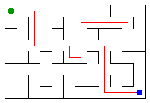

# Assignment 3. Maze Escape

Student ID: 212521
Repository: https://github.com/iblameali7/daas5
Maze size (rows x columns): 10 x 8 (80 cells, 142 walls)

This file is the report. The task is in `docs/Assignment3.pdf`, the setup is in `START_HERE.md`.

## Program output

The 13 lines my program prints on my data (`java -cp out Main`):

    Broken: 79
    Kept: 63
    Last broken wall: 131
    MST cost: 21478
    Heaviest broken wall: 835
    Path length: 20
    DFS visited: 38
    Dead ends: 26
    Zones: 80
    Largest zone: 1
    Is DAG: 1
    Flow stages: 18
    Fastest route cost: 21

My maze:

`java tools/Check.java` shows that the three examples (tiny, small, dag) give the right output.

## Questions

### Mission 0. DSU

`find(x)` returns the root of the group of x. Two cells are in one group exactly when they have the same root. While walking up to the root, I hang every cell on the way directly on the root (path compression), so the next `find` is faster. `union(a, b)` finds both roots; if they are equal it returns false and changes nothing, otherwise the smaller tree goes under the larger one (union by size), `count` goes down by 1 and it returns true. Both tricks together make an operation almost constant time (inverse Ackermann). `find` is a loop, not a recursion, so a chain of a million cells cannot overflow the stack.

### Mission 1. Why Broken is R*C - 1 and Kept is (R-1)*(C-1)

At the start every cell is its own group: R*C groups. A wall is broken only when `union` returns true, and every true `union` makes the number of groups smaller by exactly 1. The maze is connected, so at the end there is one group. Going from R*C groups to 1 takes exactly R*C - 1 successful unions, so Broken = R*C - 1. The number of all inner walls is R*(C-1) + C*(R-1) = 2*R*C - R - C. Kept = (2*R*C - R - C) - (R*C - 1) = R*C - R - C + 1 = (R-1)*(C-1). For my maze: Broken = 80 - 1 = 79, Kept = 63.

### Mission 2. Cheapest maze

Kruskal gives 21478 and Prim gives 21478. Kruskal sorts the walls by cost and breaks a wall when `union` returns true. Prim starts from cell 0 and grows the maze: it always takes the cheapest wall that leads from the built part to a new cell (priority queue, an old entry for a cell that is already inside is skipped). All wall costs are different, so the cheapest maze (minimum spanning tree) is unique, and both algorithms find the same one, so the costs are equal.

### Mission 3. Escape

The maze of Mission 1 has R*C cells and R*C - 1 open walls and it is connected, so it has no cycle: it is a tree. In a tree there is exactly one path between two cells. If there were two different paths, they would make a cycle, but a wall that would close a cycle is never broken (its `union` returns false). To avoid a stack overflow on a 1000 x 1000 maze, DFS is written without recursion: an array `stack` keeps the current path, and an array `next` keeps the direction (up, right, down, left) that each cell tries next. A cell is marked as visited when it is found, so `DFS visited` counts the marked cells at the moment the exit is marked. When all four directions of a cell are tried, I remove it from the stack and go back. The path is the content of the stack. `Dead ends` are cells with exactly one open door.

### Mission 4. Zones

Kosaraju: the first pass is DFS on the slides, and cells are written down in the order they are finished. The second pass goes over the cells from the last finished to the first, and it runs DFS on the reversed slides; each run collects one zone. The second pass is on the reversed graph because the cell that finished last lies in a zone that no other zone can reach. In the reversed graph all arrows are turned, so from this zone there is no way out, and DFS collects exactly this zone and does not leak into other zones. With the original arrows it would run into other zones and glue them together. The slides have no cycle exactly when Zones = number of cells. If there is a cycle, its cells can reach each other, so they are in one zone and the zones are fewer than the cells. If there is no cycle, no two different cells can reach each other (there is no slide from a cell to itself), so every cell is a zone of its own.

### Mission 5. Fastest route

The zones are numbered in the order of the second pass, which is a topological order of the graph of zones: every edge goes from a smaller number to a larger one. So when the pass reaches a zone, all edges into it are already processed, its value is final, and one pass in the order of the numbers is enough. A priority queue is not needed. For every zone I keep the longest chain that ends in it (for Flow stages) and the cheapest cost from the zone of the start (for Fastest route cost); each slide between different zones updates the zone it leads to. Slides inside a zone are skipped, because walking inside a zone is free. The cost of the pass is O(n + m): every cell and every slide is looked at a constant number of times (the slides are grouped by zone with a counting sort, no extra log factor).

## AI assistance

Claude (Anthropic) was used as an assistance tool during development. It helped with parts of the implementation, explanations of the algorithms, Git guidance, and an initial draft of some README content. I reviewed the project and ran the provided checks with `tools/Check.java` as well as tests on my maze data. The benchmark figures below were obtained in a Linux environment using `java -cp out Bench`; they were not measured on my own computer.

## Timing

Milliseconds, average of 5 runs, from `java -cp out Bench`.

| maze | Kruskal | Prim |
|---|---|---|
| 100 x 100 | 15 | 14 |
| 300 x 300 | 76 | 68 |
| 1000 x 1000 | 311 | 1037 |

The number of cells grows 100 times from 100 x 100 to 1000 x 1000, and Kruskal becomes about 20 times slower and Prim about 74 times slower, so the time grows a bit faster than the number of walls, as expected for O(m log m); the small sizes are also helped by the JVM warm-up. On small mazes both are about equal. On the large maze Prim is more than three times slower than Kruskal, most likely because the priority queue stores boxed `Long` objects and can hold up to 2m entries, while Kruskal only sorts a plain `long[]` array and then makes cheap DSU calls.

## Complexity

n is the number of cells, m the number of walls (or slides), z the number of zones.

| algorithm | time | space | assumptions |
|---|---|---|---|
| DSU find and union | O(alpha(n)) per operation, almost constant | O(n) | union by size and path compression together |
| Kruskal | O(m log m) | O(n + m) | sorting the walls dominates, the DSU part is about O(m alpha(n)) |
| Prim | O(m log m) | O(n + m) | binary heap (PriorityQueue), lazy deletion: up to 2m entries |
| DFS (Escape) | O(n + m) | O(n) | iterative, own stack array, every cell and open door is looked at a constant number of times |
| Kosaraju | O(n + m) | O(n + m) | two DFS passes, lists of slides and of reversed slides |
| Route in the zone graph | O(n + m) | O(n + m) | one pass over the zones in topological order, each slide once, no priority queue |
